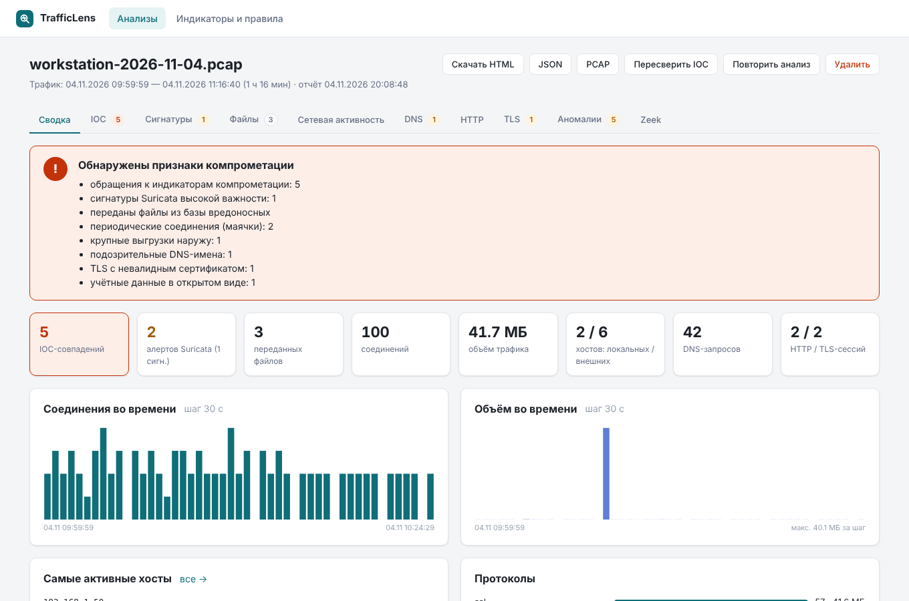
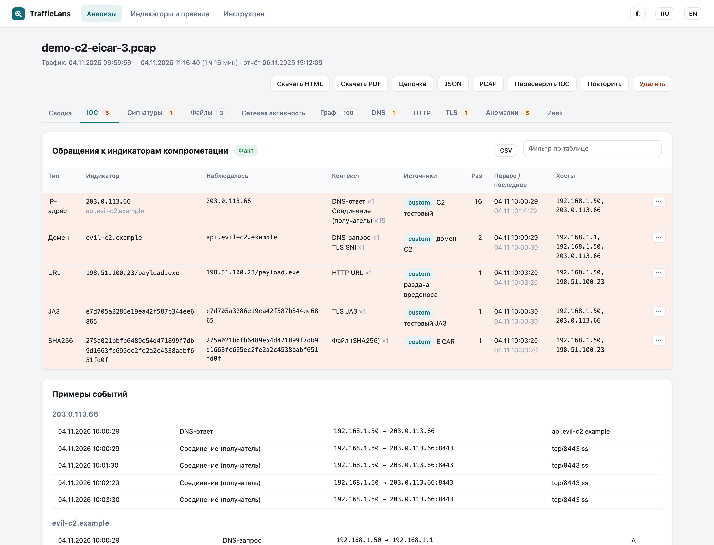
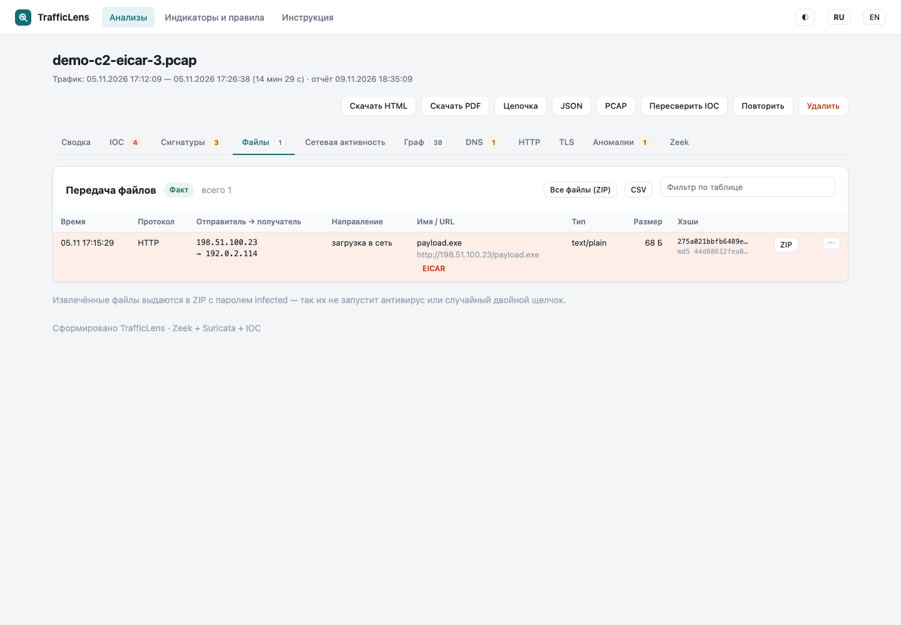
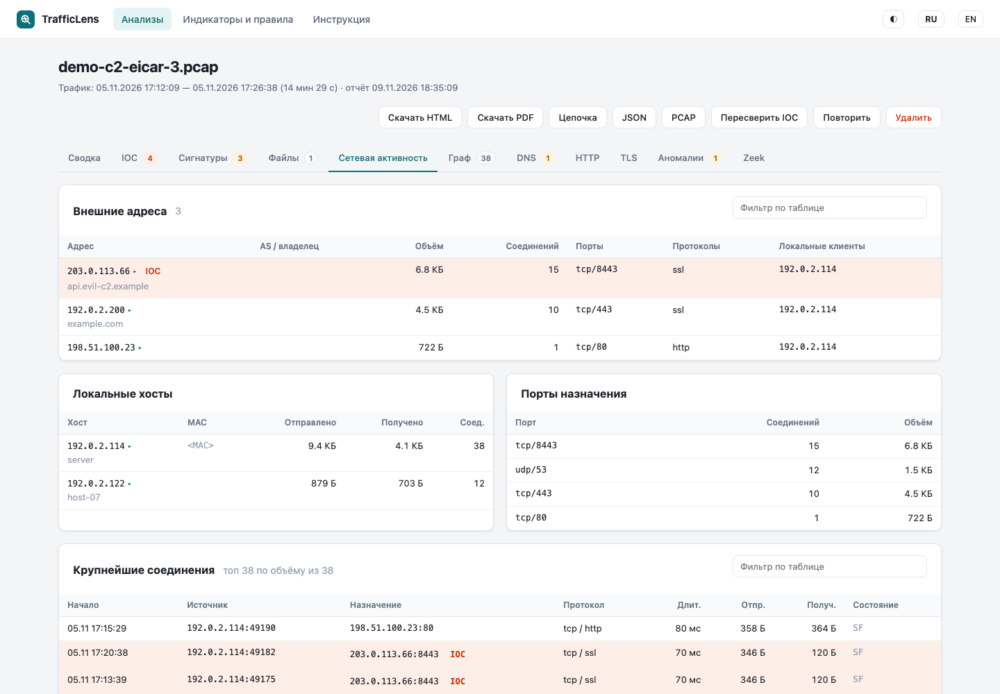
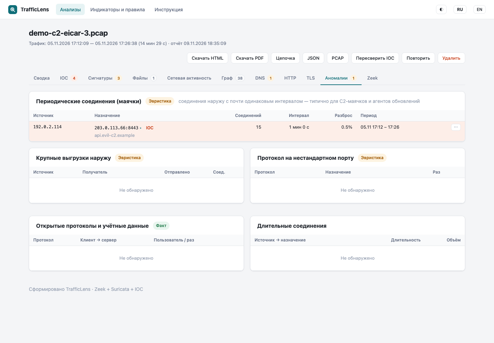

# TrafficLens

Анализ сетевого трафика в контейнере Podman. **Zeek** разбирает протоколы и извлекает переданные файлы, **Suricata** проверяет трафик сигнатурами ET Open, а слой на Python сверяет результат с индикаторами компрометации и собирает отчёт. Отчёт открывается в веб-интерфейсе и скачивается одним HTML-файлом.



## Возможности

- **Источник трафика**: PCAP/PCAPNG (в том числе `.gz`) через веб-интерфейс или командную строку, а также **живой захват** с интерфейса хоста: tcpdump пишет файлы с ротацией, и каждый закрытый файл анализируется автоматически.
- **Сетевая активность**: соединения и объём во времени, самые активные хосты, внешние адреса с именами из DNS и TLS SNI, протоколы, порты, крупнейшие соединения, локальные хосты (имя из DHCP, MAC).
- **Передача файлов** по HTTP, FTP, SMB, SMTP и т. д.: кто кому передал, направление, имя, URL, MIME, размер, MD5, SHA1, SHA256. Сами файлы скачиваются в ZIP с паролем `infected`.
- **Обращения к IOC**: IP и подсети, домены (с поддоменами), URL, хэши файлов, JA3/JA4. По каждому совпадению видно, где оно найдено (DNS-запрос или ответ, соединение, HTTP, SNI, файл), из какого источника индикатор, сколько раз и какие хосты участвовали.
- **Источники IOC**: свои списки (с редактором в интерфейсе), abuse.ch (URLhaus, ThreatFox, Feodo Tracker, MalwareBazaar), MISP, OpenCTI. Обновляются по расписанию.
- **Сигнатуры Suricata**: ET Open через suricata-update, обновляются по расписанию.
- **Аномалии**: периодические соединения наружу (маячки), крупные выгрузки, протоколы на нестандартных портах, открытые протоколы и логины в открытом виде, длительные соединения, подозрительные DNS-имена, TLS с невалидным сертификатом.
- **Итог**: «Компрометация», «Подозрительно» или «Чисто» со списком причин.
- **Пересверка IOC** по уже готовым логам за секунды, без повторного прогона Zeek и Suricata.
- **Автономный отчёт**: HTML без внешних ресурсов, работает офлайн. Есть и JSON.

| | |
|---|---|
|  |  |
|  |  |

<sub>Скриншоты сделаны на демонстрационных данных из тестов: адреса из документационных диапазонов RFC 5737, домены `*.example`.</sub>

## Как устроено

```
 PCAP (веб-интерфейс / CLI) ─┐
                             ├─► очередь ─► Zeek ─► Suricata ─► сверка с IOC ─► report.json + report.html
 trafficlens-capture         │
 (tcpdump, ротация) ─► spool ┘
                                    ▲
 IOC: свои списки, abuse.ch, MISP, OpenCTI ── обновление по расписанию
 Правила: ET Open (suricata-update) ───────── обновление по расписанию
```

Один образ работает в двух режимах:
- `web`: rootless, веб-интерфейс и анализ;
- `capture`: rootful, `--network=host`, только tcpdump.

Все данные хранятся в одном каталоге, монтируемом как `/data`.

## Быстрый старт

```bash
podman build --format docker -t localhost/trafficlens:latest .

mkdir -p ~/trafficlens/data
podman run --rm -p 8095:8080 -v ~/trafficlens/data:/data:z localhost/trafficlens
# → http://<хост>:8095
```

Разовый анализ из командной строки:

```bash
podman run --rm -v ~/trafficlens/data:/data:z -v "$PWD":/work:z localhost/trafficlens \
    analyze /work/capture.pcap -o /work/report.html
```

## Документация

| | |
|---|---|
| [Установка на RED OS](docs/installation.md) | сборка, Quadlet, каталог данных, секреты, firewalld, SELinux, Caddy, обновление |
| [Интерфейс](docs/ui.md) | страницы, темы, языки, вкладки отчёта, скриншоты |
| [Руководство администратора](docs/admin.md) | учётная запись, обновление, IOC и правила, хранение, резервное копирование, диагностика |
| [Живой захват](docs/capture.md) | контейнер захвата, интерфейс и BPF-фильтр, хранение, права |
| [Индикаторы компрометации](docs/iocs.md) | источники, формат своих списков, MISP, OpenCTI, abuse.ch |
| [Отчёт](docs/report.md) | разделы отчёта, логика итога, эвристики и их настройка |
| [Решение проблем](docs/troubleshooting.md) | типичные ошибки при установке и анализе |
| [Roadmap](docs/roadmap.md) | план релизов 0.2.0 / 0.3.0 / 0.4.0 |
| [Конфигурация](deploy/trafficlens.yaml.example) | пример `trafficlens.yaml` со всеми параметрами |

## Проверено

- Zeek 9.0.1 (`docker.io/zeek/zeek:lts`), Suricata 7.0.10 и suricata-update 1.3.4 из Debian trixie, Python 3.13.
- Podman 5.8 (rootless и Quadlet) на RED OS, x86-64.

## Разработка

```bash
pip install -r requirements.txt pytest
python3 -m pytest -q                 # тесты на эталонных логах Zeek/Suricata, без самих движков
TL_DATA_DIR=/tmp/tl python3 -m trafficlens web
```

| Модуль | Назначение |
|---|---|
| `trafficlens/runner.py` | запуск Zeek и Suricata, обновление правил |
| `trafficlens/report.py` | агрегация логов, эвристики, сверка с IOC, итог |
| `trafficlens/feeds.py` | источники IOC |
| `trafficlens/ioc_store.py`, `ioc_types.py` | база индикаторов, нормализация, индекс для сверки |
| `trafficlens/web.py`, `worker.py` | веб-интерфейс (Flask), очередь, планировщик, приём файлов захвата |
| `trafficlens/templates/report.html` | шаблон отчёта (общий для веб-интерфейса и автономного HTML) |
| `trafficlens/zeek/trafficlens.zeek` | JSON-логи, хэши и извлечение файлов в Zeek |
| `tools/make_test_pcap.py` | генератор тестового PCAP (только стандартная библиотека) |

## Лицензия

[GPL-3.0](LICENSE). Автор — [ArsIS-02](https://github.com/ArsIS-02).
