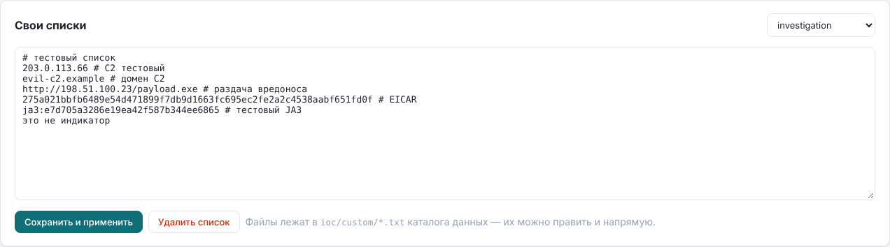

# Индикаторы компрометации

IOC хранятся в SQLite в каталоге данных. Каждое совпадение в отчёте показывает, из какого источника пришёл индикатор и с каким описанием.



## Источники

| Источник | Что даёт | Режим | Нужно |
|---|---|---|---|
| Свои списки | любые типы | полный снимок | файлы `ioc/custom/*.txt` или редактор в интерфейсе |
| abuse.ch ThreatFox | IP:порт, домены, URL, хэши (за 7 дней) | накопление | Auth-Key |
| abuse.ch URLhaus | свежие URL раздачи вредоносов | накопление | Auth-Key |
| abuse.ch Feodo Tracker | IP C2-серверов ботнетов | полный снимок | — |
| abuse.ch MalwareBazaar | хэши образцов за 48 ч | накопление | Auth-Key |
| Spamhaus DROP / DROPv6 | угнанные и «чёрные» сети (CIDR), confidence 90 | полный снимок | — |
| ET compromised IPs | скомпрометированные хосты от Emerging Threats, confidence 60 | полный снимок | — |
| Tor exit nodes | выходные узлы Tor, confidence 20 — контекст, а не компрометация; по умолчанию выключен | полный снимок | — |
| MISP | атрибуты с флагом `to_ids` за N дней | полный снимок | url + key |
| OpenCTI | STIX-индикаторы с действующим `valid_until` | полный снимок | url + token |

Режимы:
- **полный снимок** — после обновления в базе остаётся ровно то, что вернул источник;
- **накопление** — свежие записи добавляются, записи старше `iocs.max_age_days` (по умолчанию 90) удаляются.

Обновление идёт каждые `iocs.update_hours` часов (по умолчанию 6) или по кнопке на странице «Индикаторы и правила». Там же видны статус и последняя ошибка каждого источника и есть поиск индикатора по значению.

Обновили базу, а нужно проверить старый трафик? Нажмите в отчёте «Пересверить IOC»: отчёт перестроится по готовым логам с новой базой.

Открытые списки без ключа включаются и выключаются в `iocs.public`:

```yaml
iocs:
  public:
    spamhaus_drop: true
    et_compromised: true
    tor_exits: false
```

Подсети (CIDR) сверяются через индекс по длине префикса, поэтому тысячи сетей Spamhaus не замедляют анализ больших PCAP.

## Открытые списки угроз

На странице «Индикаторы и правила» в блоке «Открытые списки угроз» собраны бесплатные TXT/CSV-фиды без ключа. Каждый включается и выключается кнопкой, обновляется вместе с остальными источниками и виден в отчёте под своим именем (`list-<id>`).

| Группа | Списки | По умолчанию |
|---|---|---|
| C2 и раздача вредоносов | C2IntelFeeds (C2 IP и домены за 30 дней), Threatview (C2 Hunt, IP, домены, URL, MD5, SHA), DigitalSide (IP, домены, URL) | включены |
| Фишинг | OpenPhish Community (только некоммерческое использование) | включён |
| Сканеры и атакующие | IPsum (уровень 3+), blocklist.de, CINS Army, GreenSnow | выключены |

Сканеры и брутфорсеры в домашней сети за NAT в основном стучатся снаружи. Если у вас нет хостов с открытыми портами, эти списки дадут в основном шум, поэтому по умолчанию они выключены.

Свой список добавляется формой «Добавить свой список»: URL, название, тип индикаторов (или «авто») и уверенность 1–100. Уверенность умножает вес совпадения в score. Правила разбора одинаковы для всех списков:
- в каждой строке берётся первое поле, похожее на индикатор нужного типа, а остаток строки CSV становится описанием;
- комментарии `#`, `;` и `//` пропускаются;
- частные, служебные адреса и сети шире /8 (IPv6 — /16) отбрасываются, чтобы битый список не пометил всю домашнюю сеть.

Выключенный список сразу удаляется из базы, и его индикаторы перестают срабатывать.

Включение пресета можно закрепить в конфиге. Тогда переключатель в интерфейсе не действует:

```yaml
iocs:
  lists:
    blocklist-de: {enabled: true}
    openphish: {enabled: false}
```

## Ретропроверка

После каждого обновления IOC (по расписанию, по кнопке или после сохранения своего списка) индикаторы, появившиеся в базе после прошлой проверки, сверяются с трафиком задач за последние `retro.days` дней (по умолчанию 30). Пример: адрес попал в ThreatFox сегодня, а хост ходил на него во вторник. Это и будет найдено.

- Сверяются адреса, домены (с поддоменами), URL, хэши файлов и JA3/JA4. Они извлекаются из логов Zeek и Suricata один раз и кешируются в `observables.json` в каталоге задачи, поэтому повторные проверки почти ничего не стоят.
- В ретропроверку попадают только совпадения, которых не было в отчёте на момент анализа. Затронутый отчёт пересобирается с актуальной базой, и вердикт пересчитывается.
- Новые совпадения видны на главной (блок «Ретропроверка» и бейдж «ретро N» у задачи) и баннером в отчёте. Кнопка «Отметить просмотренными» убирает их с главной, но не из отчёта.
- На странице «Индикаторы и правила» показан последний запуск. Кнопка «Проверить новые IOC» запускает проверку вручную, «Полная проверка» сверяет всю базу IOC.
- Из командной строки: `podman exec trafficlens python3 -m trafficlens retro [--full]`.

```yaml
retro:
  enabled: true
  days: 30         # глубина: задачи, завершённые не раньше N дней назад
  max_jobs: 2000   # не больше N последних задач за проход
```

## Allowlist

На странице «Индикаторы и правила» ведётся глобальный allowlist: индикаторы, сигнатуры и эвристики, подтверждённые как ложные. Такие находки остаются видны в отчётах (значок WL), но не влияют на вердикт и риск хостов ни в одной задаче. Пополняется из отчёта: кнопка ⋯ у находки → «В allowlist»; там же и удаление. Подробнее о статусах находок — в [report.md](report.md#разметка-аналитиком).

## Дополнительные источники правил Suricata

Кроме ET Open можно подключить свои наборы правил по URL — ET Pro, abuse.ch SSLBL, внутренние `.rules` на своём сервере. Добавляются на странице «Индикаторы и правила» → «Дополнительные источники правил»; suricata-update скачает их вместе с ET Open при ближайшем обновлении (или сразу по кнопке «Обновить правила»).

## Типы и правила совпадения

| Тип | Где ищется | Как сравнивается |
|---|---|---|
| IP | адреса соединений, DNS-ответы, HTTP Host | точно; для `IP:порт` в отчёте отмечается и совпадение порта |
| Подсеть (CIDR) | то же | вхождение адреса в подсеть |
| Домен | DNS-запросы и CNAME, HTTP Host, TLS SNI | сам домен и все поддомены: `evil.example` совпадёт с `a.b.evil.example` |
| URL | HTTP-запросы (только открытый HTTP) | без схемы, хост в нижнем регистре, без порта по умолчанию |
| MD5 / SHA1 / SHA256 | файлы, извлечённые Zeek | точно |
| JA3 / JA4 | TLS ClientHello (по данным Suricata) | точно |

## Свои списки

Любые файлы `*.txt` в `<каталог данных>/ioc/custom/`. Их можно править прямо в интерфейсе: «Индикаторы и правила» → «Свои списки». Формат — по одному индикатору в строке, тип определяется автоматически, текст после ` #` попадает в отчёт как описание:

```
# расследование 2026-11
203.0.113.66                 # C2
203.0.113.66:8443
198.51.100.0/24
evil.example                 # совпадёт и с поддоменами
https://bad.example/x.exe
44d88612fea8a8f36de82e1278abb02f
ja3:e7d705a3286e19ea42f587b344ee6865   # для JA3 префикс обязателен, иначе это MD5
ja4:t13d1516h2_8daaf6152771_02713d6af862
```

Тип можно указать явно префиксом: `ip:`, `cidr:`, `domain:`, `url:`, `md5:`, `sha1:`, `sha256:`, `ja3:`, `ja4:`. Нераспознанные строки пропускаются, и интерфейс показывает их список после сохранения. После правки файлов вручную нажмите «Обновить» у источника «Свои списки» или выполните `update-iocs --source custom`.

## abuse.ch

С 2025 года URLhaus, ThreatFox и MalwareBazaar требуют бесплатный Auth-Key:

1. Войдите на <https://auth.abuse.ch/> через один из предложенных аккаунтов.
2. Создайте в профиле Auth-Key.
3. Впишите его в `~/.config/trafficlens.env`: `TL_ABUSECH_KEY=…`. Можно и в `iocs.abusech.auth_key` в `trafficlens.yaml`.
4. Перезапустите сервис: `systemctl --user restart trafficlens`.

Feodo Tracker работает и без ключа. Ошибки `HTTP 401` и `HTTP 403` на странице источников означают, что ключ не задан или скопирован не полностью.

Отдельные источники выключаются в `trafficlens.yaml`:

```yaml
iocs:
  abusech:
    urlhaus: false
```

## MISP

```yaml
iocs:
  misp:
    enabled: true
    url: "https://misp.example"
    key: ""                 # или TL_MISP_KEY
    verify_tls: true        # true / false / путь к CA, например /data/config/ca.crt
    days: 30                # атрибуты, опубликованные за N дней
    to_ids_only: true
```

Используются типы `ip-src`, `ip-dst`, `ip-src|port`, `ip-dst|port`, `domain`, `hostname`, `domain|ip`, `url`, `uri`, `link`, `md5`, `sha1`, `sha256`, `filename|md5`, `filename|sha1`, `filename|sha256`, `ja3-fingerprint-md5` и `ja4-fingerprint`. Описанием индикатора становится название события MISP.

## OpenCTI

```yaml
iocs:
  opencti:
    enabled: true
    url: "https://opencti.example"
    token: ""               # или TL_OPENCTI_TOKEN
    verify_tls: true
    min_score: 0            # минимальный x_opencti_score
    max_indicators: 200000
```

Загружаются индикаторы с `pattern_type = stix`, кроме отозванных и просроченных. Из STIX-паттернов извлекаются `ipv4-addr`, `ipv6-addr`, `domain-name`, `hostname`, `url`, `file:hashes.MD5/SHA-1/SHA-256` и JA3.

Если сертификат MISP или OpenCTI выдан внутренним CA (например, FreeIPA), положите CA в `<каталог данных>/config/` и укажите путь в `verify_tls`.
