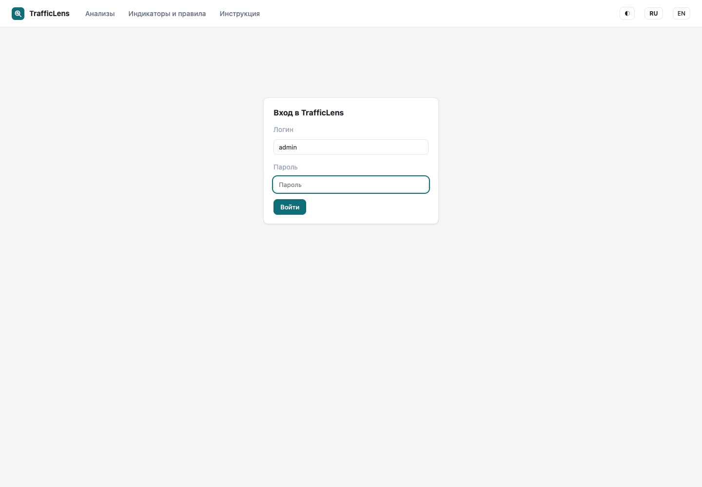
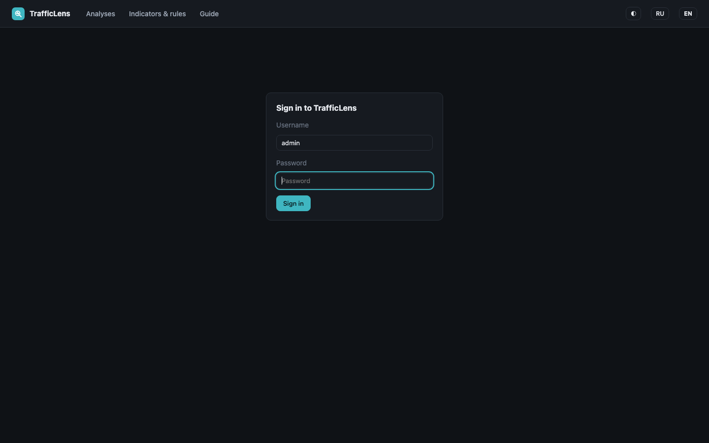
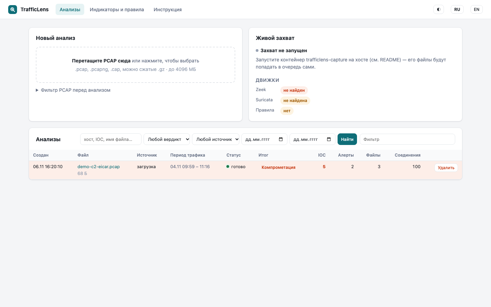
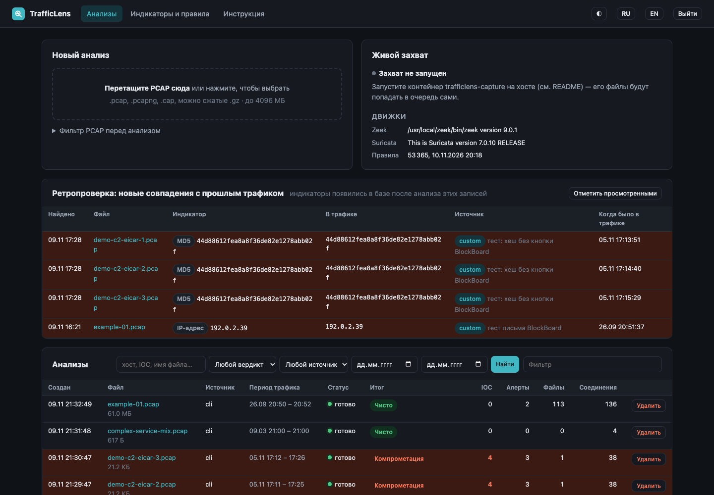
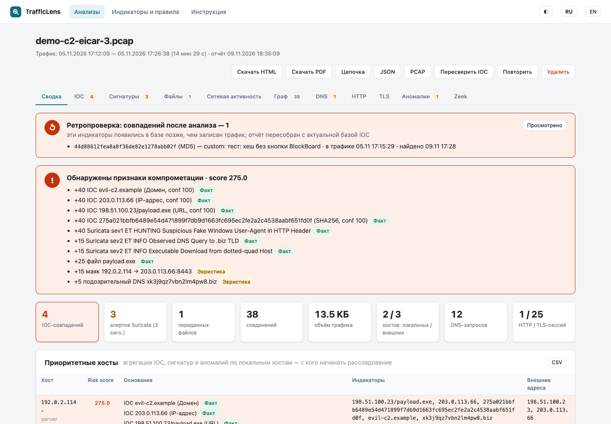
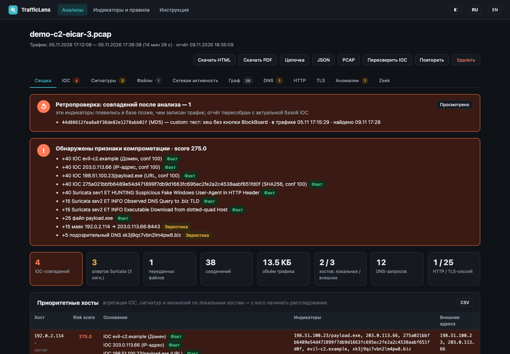
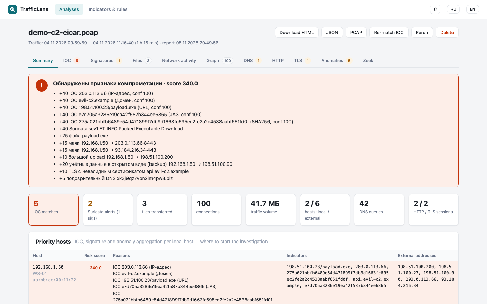
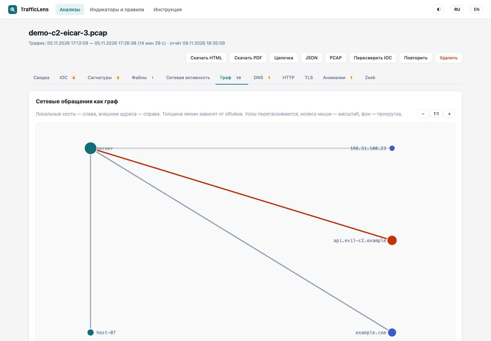
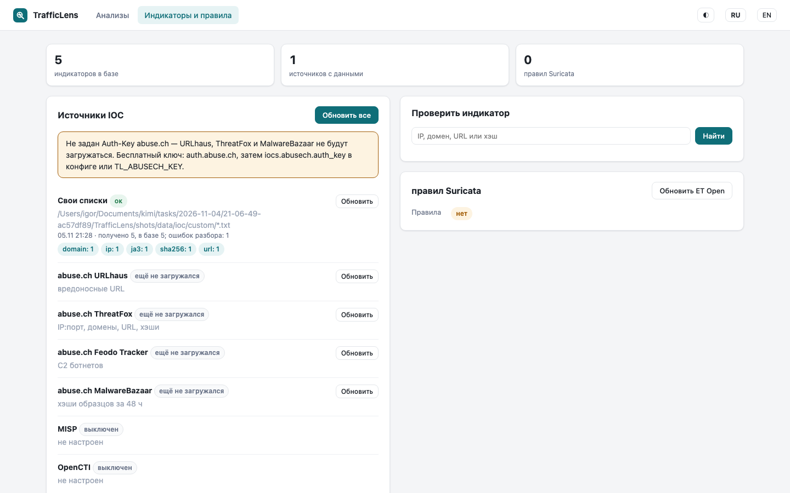
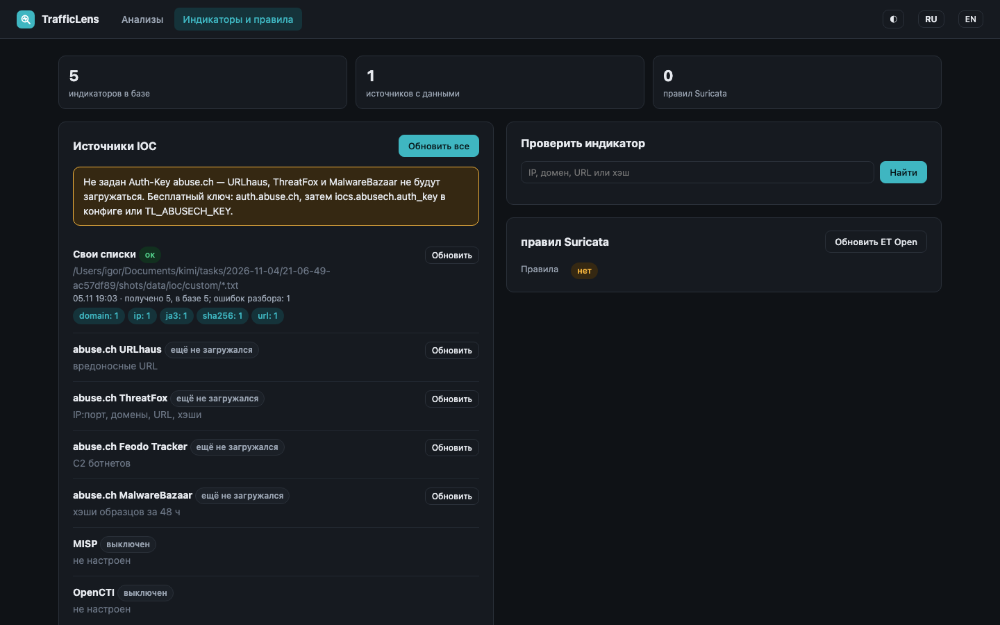

# Интерфейс TrafficLens

Веб-интерфейс состоит из трёх страниц: «Анализы», «Индикаторы и правила» и страница отчёта по задаче. Плюс страница входа, если включена аутентификация.

Общие элементы шапки:

- **◐** — переключение темы (светлая / тёмная). Выбор запоминается в браузере (`localStorage`), по умолчанию берётся системная тема.
- **RU / EN** — язык интерфейса (русский / английский). Выбор сохраняется в cookie `tl_lang`.
- **Выйти** — показывается только после входа.

## Вход

Если задан пароль (`auth.password` или `auth.password_hash`), интерфейс закрыт формой входа. Логин по умолчанию — `admin` (настраивается через `auth.username` / `TL_USERNAME`). После 5 неудачных попыток за 10 минут вход временно блокируется.

## Анализы

Главная страница: загрузка PCAP и список задач.

- **Новый анализ** — перетащите PCAP в пунктирную область или нажмите и выберите файл. Поддерживаются `.pcap`, `.pcapng`, `.cap`, в том числе сжатые `.gz`.
- **Живой захват** — статус контейнера захвата и доступность движков (Zeek, Suricata, правила).
- **Анализы** — таблица задач: время создания, файл, источник (загрузка/захват), период трафика, статус, скоринговый итог и счётчики (IOC, алерты, файлы, соединения). Строка с вердиктом «Компрометация» подсвечивается. Фильтр в правом верхнем углу ищет по всем колонкам.

## Отчёт

Открывается кликом по задаче. Шапка: имя файла, период трафика, кнопки действий — скачать автономный HTML-отчёт, PDF-версию (конденсированная, на языке интерфейса), JSON, исходный PCAP, пересверить IOC (без повторного разбора), повторить анализ, удалить.

Вкладки:

- **Сводка** — скоринговый вердикт с разбивкой очков по причинам, ключевые метрики и таблица «Приоритетные хосты»: с каких локальных хостов начинать расследование.
- **IOC** — все совпадения с индикаторами: тип, значение, источник, confidence, контекст.
- **Сигнатуры** — алерты Suricata с группировкой по сигнатуре.
- **Файлы** — переданные файлы из Zeek `files.log`: имя, тип, хэши, IOC-совпадения.
- **Сетевая активность** — топ соединений и протоколов.
- **Граф** — сетевые обращения в виде графа: локальные хосты слева, внешние адреса справа, толщина линии зависит от объёма трафика, адреса из IOC выделены красным. Узлы можно перетаскивать мышью, чтобы развести пересекающиеся линии.

Интерфейс отчёта полностью переведён — включая данные находок (причины вердикта, контексты и типы IOC, направления файлов). Так выглядит та же страница в английской версии:

- **DNS / HTTP / TLS** — запросы, сессии, сертификаты и JA3.
- **Аномалии** — эвристики: маячки, крупные выгрузки, cleartext-учётные данные, невалидный TLS, подозрительный DNS.
- **Zeek** — статус разбора и список логов.

## Индикаторы и правила

- Сводка: сколько индикаторов в базе, сколько источников дали данные, сколько правил Suricata загружено.
- **Источники IOC** — статус каждого фида (свои списки, abuse.ch, MISP, OpenCTI), кнопки обновления по одному или всех сразу. Если не задан ключ abuse.ch, показывается подсказка.
- **Проверить индикатор** — ручная проверка IP, домена, URL или хэша по базе.
- **Свои списки** — создание и редактирование локальных списков IOC (файлы `ioc/custom/*.txt` в каталоге данных).
- **Правила Suricata** — путь к набору правил, число правил, дата обновления, кнопка обновления ET Open.

